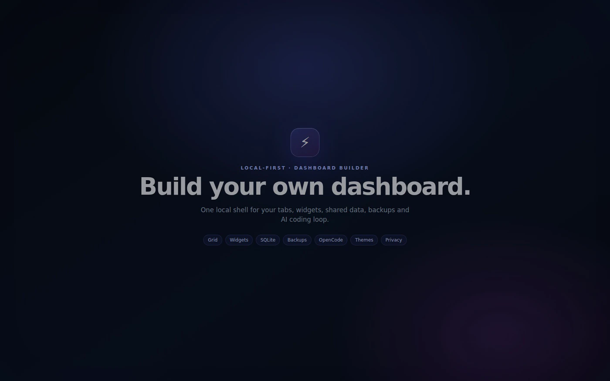
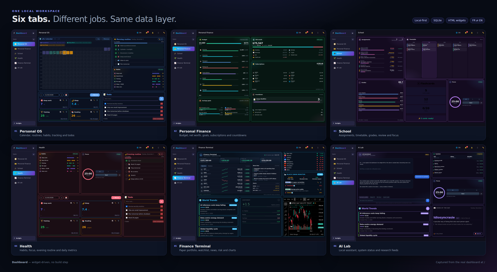
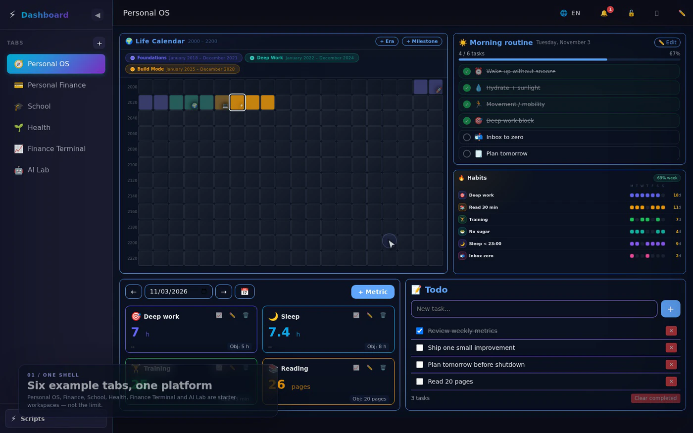
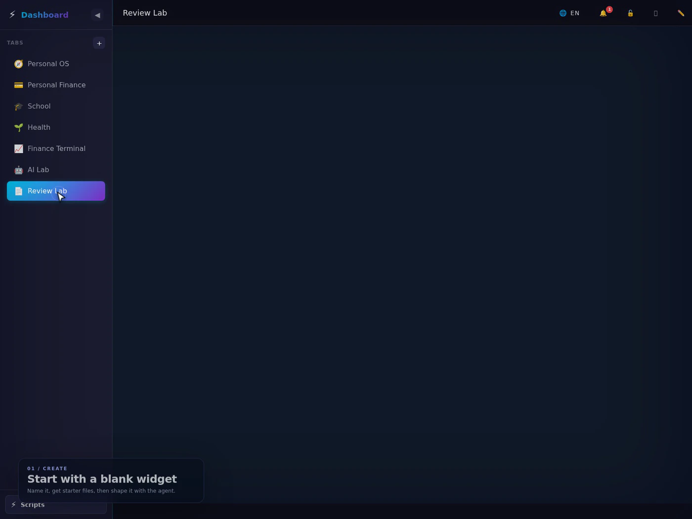
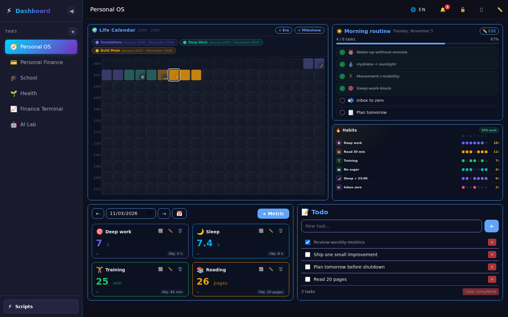
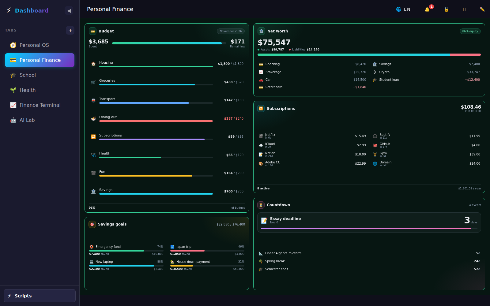
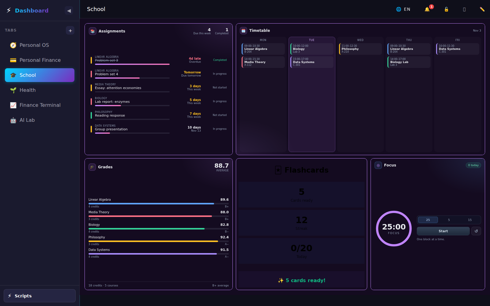
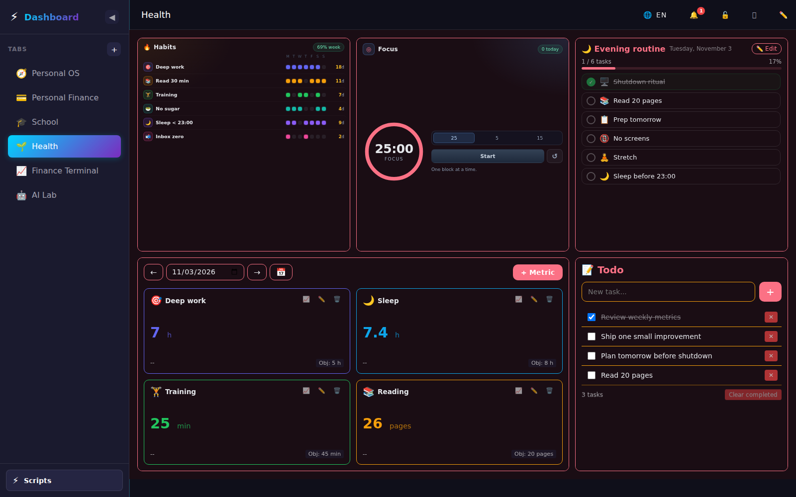
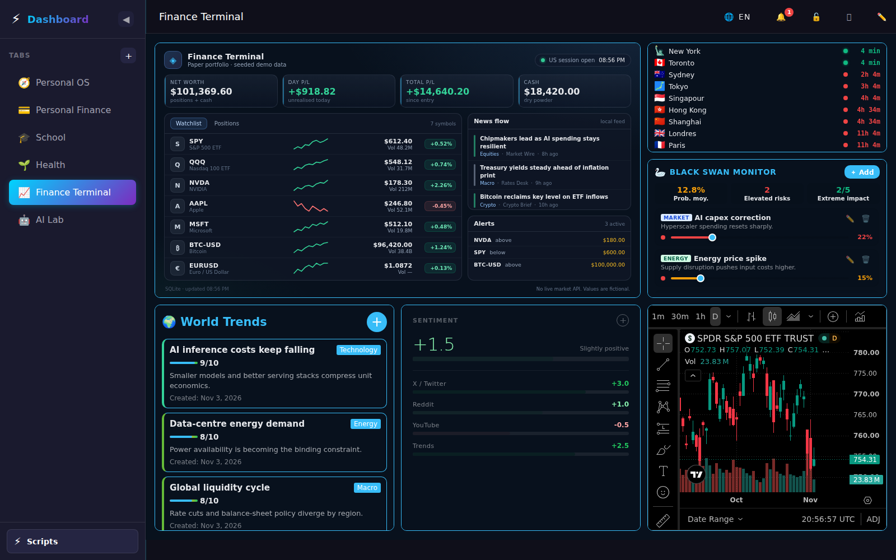
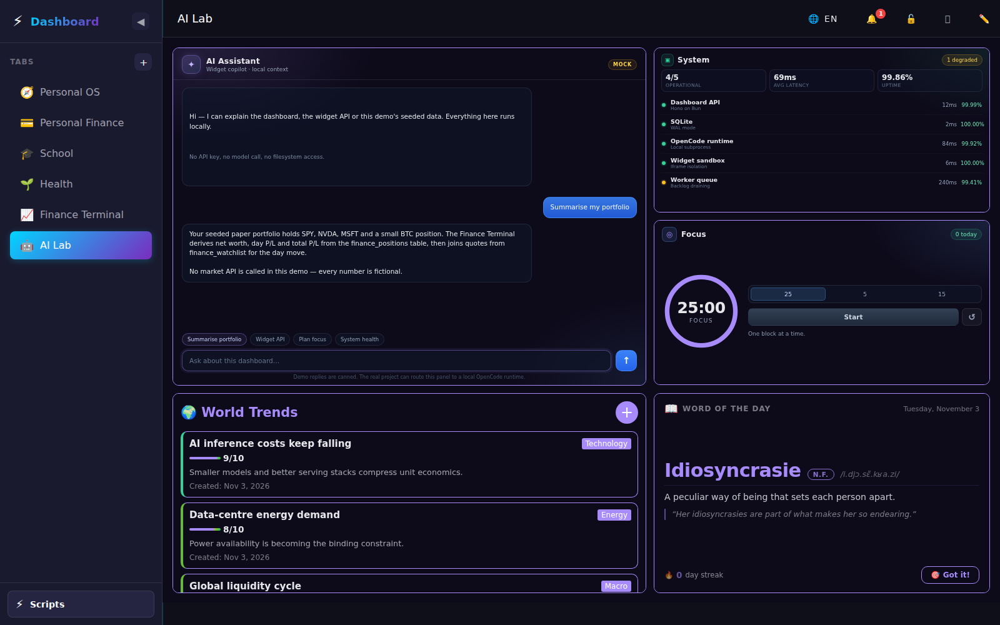

<p align="center">
  
</p>

<p align="center"><a href="https://dynamic-dashboard-edouwarden.vercel.app/"><strong>▶&nbsp;&nbsp;Open the live demo</strong></a></p>

# Dashboard

A local-first builder for custom dashboards and small tools. One Bun process serves the shell, a shared SQLite database, isolated HTML widgets, file backups, themes, privacy mode and an optional OpenCode agent that edits your widgets from inside the UI.

The point is not another SaaS dashboard, and not a fixed set of tabs. It is the layer around your tools: any number of dashboards and pages, a grid that stays out of the way, widgets that share the same data, and a coding loop that turns a description into a working panel.

> All seeded data is fictional. No market API, AI model or external account is required to run the app.

> **Project status: archived.** Development of this web version has stopped. A rework is planned as an Electron-equivalent desktop app. The repository remains available as a portfolio reference.

## Why this instead of another app

A dedicated app gives you one UI, one account and one data silo. This project gives you the shell around many tools:

- **Grid mechanics** — tabs and pages, a 24-column grid, drag, resize, snap and persisted positions.
- **Vibe coding** — describe a panel in the widget editor and let OpenCode edit its files, with database access you control.
- **Backups around your work** — per-widget file snapshots with one-click restore, plus tab-level backups.
- **Shared data** — every widget queries the same SQLite database; grant tables per widget and read the same records across tools.
- **Privacy mode** — blur the whole workspace, then reveal one panel at a time.
- **Themes** — presets, colors, typography, borders and shadows, stored per tab.
- **One place for everything** — dashboards, database explorer, scripts, notifications and a PWA shell.
- **Bilingual UI** — French ⇄ English across the shell and widget iframes.

## What it looks like

The real dashboard lives at `/` and is the source of every screenshot and recording here. The seed ships six example tabs to show range: a personal OS, finance, school, health, a finance terminal and an AI lab. They are examples, not the product — delete them and build tabs for your own work.



| Example tab | What it demonstrates |
|---|---|
| **🧭 Personal OS** | Life calendar, morning routine, habit streaks, metrics and a todo board. |
| **💳 Personal Finance** | Budget planner, net worth, savings goals, subscriptions and a countdown. |
| **🎓 School** | Assignments, grade tracker, class timetable, flashcards and a focus timer. |
| **🌱 Health** | Habit streaks, a focus timer, routines, daily tracking and a todo board. |
| **📈 Finance Terminal** | Paper portfolio, watchlist, news flow, alerts, market hours, sentiment and a chart. |
| **🤖 AI Lab** | Mock AI assistant, system status and the widgets an agent can reason about. |

The interface switches between **French and English** from the header. The choice is stored locally and applied to the dashboard shell and to same-origin widget iframes; dates, counters and placeholders follow the active language too.

### Feature tour



The trailer at the top is the fast cut: six example tabs, an in-place OpenCode prompt on a real widget, then an empty **Command Center** tab filled with 17 existing widgets as a timelapse, a pass through the style picker, and a nine-theme montage. Same build, same data, no scripted mock screens. This tour is the slower pass: enter edit mode, resize a panel, grant a widget access to a shared table, snapshot it, swap the tab theme, blur the workspace and switch the whole UI to French.

## Build a widget with the agent



1. Enter edit mode and open **Create widget**. Name it; the app generates `index.html`, `style.css`, `app.js` and `manifest.json`.
2. Open **Permissions** and assign existing SQLite tables. The widget can only touch what you allow, and the same rows remain available to other widgets.
3. In the **OpenCode** panel, describe the tool you want. The agent edits the widget files in place while the preview refreshes.
4. Open **Backups** and create a snapshot. Each widget keeps its own file history; restore is one click.
5. Ask OpenCode for a different direction, then restore the snapshot.
6. Undo the restore to bring back the newer state — the restore itself creates a pre-restore snapshot.
7. Add it from the gallery, then repeat for a second widget on the same table. Resize both and leave edit mode; positions persist in SQLite.

The recording follows that loop end to end: it creates **Flashcard Review**, grants it the shared `flashcards` table, snapshots it, switches it to a focus mode, restores and undoes the restore, then builds **Card Stats** on the same table and shows both panels side by side.

## Screens from the example tabs

| Personal OS | Personal Finance |
|---|---|
|  |  |

| School | Health |
|---|---|
|  |  |

| Finance Terminal | AI Lab |
|---|---|
|  |  |

The tab screenshots were captured from `/` at 1600×1000 in English mode; the overview is a montage of those captures. The trailer, feature tour and widget demo are Playwright recordings converted to optimized GIFs.

## Platform capabilities

- **Dashboards, tabs and pages** — build as many as you need, each with its own layout, style and widget instances.
- **Grid mechanics** — a 24-column grid with drag, resize, snapping and positions stored in SQLite.
- **Widget builder** — create a widget from scratch; the app generates a working starter with a manifest, HTML, CSS and JS.
- **Vibe coding with OpenCode** — describe a widget or the dashboard in natural language and let the agent edit the files, with a permissioned database workflow.
- **Backups and rollback** — per-widget file snapshots, tab backups, style presets and one-click restore.
- **Shared SQLite** — one database behind every panel, plus a table explorer with schemas, rows, CRUD and per-widget table permissions.
- **Themes per tab** — presets, colors, typography, borders and shadows, injected into widgets as CSS variables.
- **Privacy mode** — blur the workspace and reveal individual panels when needed.
- **Bilingual UI** — FR⇄EN switching with persistence, browser-language detection and iframe translation.
- **Starter gallery** — 28 example widgets across personal organisation, finance, school, trading and developer tools. They are building blocks and references, not the product boundary.
- **A composite Finance Terminal** — one widget that combines portfolio, watchlist, news, alerts, market hours and a chart.
- **Global scripts** — CRUD, a Monaco editor, cron/webhook/event triggers, execution logs, backups and SSE output.
- **Notifications** — global and tab-scoped notifications with a notification center.
- **PWA** — manifest, service worker and an installable shell.

## Stack

| Layer | Choice |
|---|---|
| Runtime | [Bun](https://bun.sh/) |
| HTTP | [Hono](https://hono.dev/) with `serveStatic` and SSE streaming |
| Database | SQLite via `bun:sqlite` |
| Frontend | Vanilla HTML/CSS/JS ES modules, no bundler |
| Widget isolation | Same-origin `iframe` per widget instance |
| Realtime | Server-Sent Events |
| Editor | Monaco (scripts) |
| Agent | OpenCode CLI through a local subprocess |
| Deployment target | Any machine that can run Bun; demo mode is safe to expose read-only |

## Run it

**Requirements:** Bun 1.4+ and a writable `data/` directory. No Node runtime is needed for the dashboard itself; the optional OpenCode integration uses the `opencode` CLI and a small Node PTY helper.

```bash
bun install
bun run seed
bun run dev
```

Open <http://localhost:3000/>.

`bun run seed` creates the SQLite database and the six-tab layout only if they are missing. Use `bun run seed --reset` to rebuild both the real and demo environments from the deterministic seed.

## Optional demo mode

`/demo` is an optional local presentation mode for sharing the UI without exposing real data. It runs the **same frontend** against an isolated database and tab directory:

| | Real dashboard | Demo |
|---|---|---|
| Database | `data/dashboard.db` | `data/demo.db` |
| Tabs | `tabs/` | `data/demo-tabs/` |
| Tab IDs | any | must start with `demo-tab-` |
| AI | local OpenCode CLI | deterministic mock SSE |
| Writes | enabled | enabled locally; disable with `DEMO_READ_ONLY=1` |

The demo can be reset at any time with `POST /api/demo/reset`. Nothing from the demo can read or write the real dashboard database.

## Static demo (no server)

`demo-static/` builds a completely static copy of the demo that can be hosted on Vercel, Cloudflare Pages or any file server. It ships the same shell and the same 28 widgets, but every `/api/*` call is answered in the browser by an IndexedDB engine. No database, Bun process or model is required.

```bash
bun run demo:data    # regenerate demo-static/data/seed.json from data/demo.db
bun run demo:build   # write the static site to demo-static/public
bun run demo:dev     # preview it at http://localhost:4173/
```

In the static build:

- tabs, grid positions, widget data, variables and notifications persist in IndexedDB;
- the **Reset data** control restores the seeded demo;
- widget authoring, script execution and backups are disabled with an explicit 403 message (the build is a showcase, not an editor);
- the agent is a scripted mock: three selectable prompts, canned replies streamed locally, labelled **Scripted demo agent — no model runs**.

**Live demo:** <https://dynamic-dashboard-edouwarden.vercel.app/> — the static build, with fictional data stored in the browser.

**Deploy:** on Vercel, import the repository as-is — `vercel.json` sets `sh demo-static/build.sh` and `demo-static/public`. The deploy builds with a POSIX shell only, so no runtime or dependency install is required. On Cloudflare Pages, use the same build command and output directory (also configured in `wrangler.toml`), or run `sh demo-static/build.sh && npx wrangler pages deploy demo-static/public`.

## How it works

```
Browser
  ├── Dashboard shell (tabs, grid, edit mode, notifications)
  └── <iframe> per widget instance
          │  tabId, instanceId, config in the query string
          └── POST /api/tabs/:tabId/widgets/:instanceId/query
                    │
                    ├── resolve tab + widget manifest
                    ├── check dbPermissions
                    └── SQLite (real or demo DB)
```

The server is the authority. A widget cannot run arbitrary SQL: it sends a structured query, the server looks up the widget manifest, and only the declared table/action pair is allowed.

### Widget contract

A widget lives in `data/widgets/<id>/` with `index.html`, `style.css`, `app.js` and `manifest.json`.

```json
{
  "widget": {
    "id": "widget-my-widget",
    "name": "My widget",
    "emoji": "🧩",
    "category": "tools",
    "defaultSize": { "cols": 8, "rows": 5 },
    "dbPermissions": [
      { "table": "finance_watchlist", "actions": ["select"] }
    ],
    "configSchema": {}
  },
  "version": 1
}
```

Widgets receive their context from the URL:

```js
const params = new URLSearchParams(location.search);
const tabId = params.get('tabId');
const instanceId = params.get('instanceId');
const config = JSON.parse(params.get('config') || '{}');
```

They query data with a small helper:

```js
const result = await fetch(`/api/tabs/${tabId}/widgets/${instanceId}/query`, {
  method: 'POST',
  headers: { 'Content-Type': 'application/json' },
  body: JSON.stringify({ table: 'finance_watchlist', action: 'select' }),
});
```

Colors, fonts, radius and borders are injected as CSS variables from the tab's style, so a widget inherits the active theme without hard-coding it.

### Main routes

| Route | Purpose |
|---|---|
| `/` | Real dashboard |
| `/demo` | Isolated local presentation |
| `/api/tabs/:tabId/widgets/:instanceId/query` | Widget data query |
| `/api/database/*` | Database explorer and table management |
| `/api/widgets/*` | Widget CRUD, tables, instances, OpenCode |
| `/api/scripts/*` | Script CRUD, triggers, execution, OpenCode |
| `/api/dashboard/opencode/*` | Dashboard-level agent sessions |
| `/api/demo/health` | Demo status |
| `POST /api/demo/reset` | Reseed the demo database and tabs |
| `POST /api/demo/ai/chat` | Mock AI SSE stream |

## Data and safety

Runtime data is generated, not committed:

```
data/widgets/       # tracked: widget source and manifests
data/dashboard.db   # generated
data/demo.db        # generated
tabs/               # generated
data/demo-tabs/     # generated
data/scripts/       # generated
```

The deterministic seed creates the dashboard and the demo from neutral, fictional data. Tables use generic English names (`flashcards`, `metrics`, `morning_tasks`, `risk_events`, `trend_items`, …) so the widgets read as reusable templates rather than as one person's records.

Most of the app runs locally, but a few optional widgets fetch third-party services when they render: TradingView for the price chart, YouTube for the morning playlist, and the D3/TopoJSON map assets from jsDelivr for the world heatmap. No external account or API key is required, and seeded finance data is fictional. Remove those widgets from a tab if you need a fully offline dashboard.

For a public deployment:

1. Set `DEMO_READ_ONLY=1`.
2. Keep `DEMO_AI_MODE=mock`.
3. Do not mount real tabs, scripts or OpenCode credentials into the demo process.
4. Put reset behind your own rate limit or admin check.

`.env` is ignored. `.env.example` documents the available paths and flags. No API key is needed for the app to run.

## TREEFRAG: keeping a large codebase in a small context budget

The repository keeps a **TREEFRAG** context index in [`docs/claude-context/`](docs/claude-context/):

- [`TREEFRAG_ROOT.md`](docs/claude-context/TREEFRAG_ROOT.md) is the LOD 1 skeleton, roughly 400 tokens.
- `treefrag/<branch>.md` files hold node IDs, file paths, line counts and short descriptions for one subsystem.

Why this matters for cost:

- The agent starts with a **map**, not a full repository dump.
- A targeted bug fix usually needs one branch and two focused reads.
- Long files are read by signature and line range instead of being pasted whole.
- The index is updated after edits, so the next session is cheap too.

The approach follows the TREEFRAG paper, *Stingy Context: 18:1 Hierarchical Code Compression for LLM Auto-Coding* by David Linus Ostby (ViperPrompt, December 2025). The paper itself is not bundled in this repository. The practical result here was simple: a large, multi-module codebase stayed workable in small context windows and at low per-task cost.

## Project layout

```
.
├── .github/workflows/ci.yml    # typecheck, seed and smoke test
├── index.ts                    # Hono entry point, static assets, PWA routes
├── src/
│   ├── config.ts               # env-driven paths and demo flags
│   ├── demo/seed.ts            # deterministic data + six-tab layouts
│   ├── server/                 # API, demo API, domain routes
│   ├── database/manager.ts     # SQLite + permission enforcement
│   ├── widgets/                # widget manifests, backups, fragtree
│   ├── tabs/                   # tab persistence and pages
│   ├── scripts/                # scheduler, executor, backups
│   ├── opencode/               # agent sessions and system prompts
│   └── public/                 # dashboard shell, CSS, frontend modules
├── data/widgets/               # tracked widget source
├── demo-static/                # static showcase: IndexedDB engine, seed, build
│   ├── src/                    # engine, shell shim, widget bridge
│   ├── data/seed.json          # generated demo data
│   └── build.mjs               # emits demo-static/public
├── docs/
│   ├── trailer.webp
│   ├── tour.webp
│   ├── create-widget.webp
│   ├── screenshots/
│   └── claude-context/         # TREEFRAG index
└── scripts/seed.ts             # seed both environments
```

## Commands

| Command | Description |
|---|---|
| `bun install` | Install dependencies |
| `bun run dev` | Start with watch mode |
| `bun start` | Start once |
| `bun run seed` | Create missing DB/tabs from deterministic seed data |
| `bun run seed --reset` | Rebuild both DBs and tab layouts |
| `bun run typecheck` | Run `tsc --noEmit` |
| `bun run check` | Typecheck plus `git diff --check` |
| `bun run demo:data` | Regenerate the static demo seed from `data/demo.db` |
| `bun run demo:build` | Build the static demo into `demo-static/public` |
| `bun run demo:dev` | Preview the static demo on port 4173 |
| `bun run bump` | Bump the frontend asset cache version |
| `bun run generate-emojis` | Regenerate the local emoji dataset |
| `bun run generate-icons` | Regenerate PWA icons |

Useful environment variables:

```ini
WEB_PORT=3000
HOST=localhost
DEMO_AI_MODE=mock
DEMO_READ_ONLY=0
OPENCODE_BIN=opencode
OPENCODE_MODEL=opencode-go/minimax-m2.7
```

OpenCode is optional. Without it, the real dashboard's agent panels are unavailable, but the dashboard, widgets, database and scripts still run.

## Status

This web version is archived. Development stopped in favour of a planned Electron-equivalent desktop app, so this repository is kept as a portfolio reference rather than an actively maintained product.

- The dashboard, the six example tabs and every screenshot are real and run from the tracked source.
- The seeded data and layouts are deterministic: same seed, same dashboard.
- The UI is bilingual (FR/EN); the README, user-facing copy and the TREEFRAG index are in English.
- No public live demo is linked. `/demo` runs locally with isolated data.
- CI runs the typecheck, the deterministic seed and a server smoke test.

## License

MIT. You are free to use, copy, modify and distribute this software, provided the copyright notice and this permission notice are retained. Attribution to **Edouwarden** is required.
